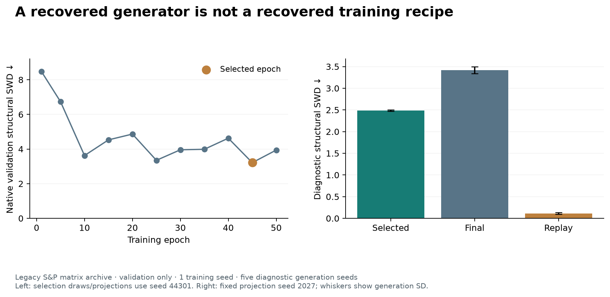

# CorrGAN and cCorrGAN

Train and inspect unconditional and conditional correlation-image generators,
import supported historical generators, and evaluate raw and repaired outputs.
Research software · **0.1.0rc2**.

## Implementation status

| Component | Current state |
|---|---|
| cCorrGAN with categorical regime | Training, validation, sampling, and repair-aware evaluation available |
| cCorrGAN with a continuous score | Explicit research extension; separate configuration |
| Published categorical cCorrGAN checkpoint | Hash-pinned PyTorch importer verified against TensorFlow; original training membership unknown |
| Original unconditional CorrGAN generator | Native PyTorch architecture/importer matches the published 80D TensorFlow checkpoint; native sampling available |
| Unconditional training | Executable DCGAN reference reconstruction; original discriminator/optimizer recipe and empirical reproduction remain unverified |
| Published empirical fidelity | Still under investigation; completed long runs are not proof of reproduction |

The target release includes proper training and generation for both CorrGAN and
cCorrGAN. Do not relabel the conditional network with a constant label as a
verified implementation of original CorrGAN.

The [model cards](docs/model_cards.md) record each variant's inputs, supported
dimensions, evidence, limitations and checkpoint availability.

## Start on CPU

Use Python 3.12 or 3.13. The exact compatible CorrBench revision is installed
from `requirements-benchmark.txt`; no sibling checkout or real dataset is needed
for this example once the coordinated repositories are public.

```bash
git clone https://github.com/gautiermarti/CorrGAN.git corrgan
cd corrgan
python3.12 -m venv .venv
source .venv/bin/activate
python -m pip install --upgrade pip
python -m pip install torch --index-url https://download.pytorch.org/whl/cpu
python -m pip install -r requirements-benchmark.txt .
python examples/generate_and_repair.py
```

On Windows, activate with `.venv\Scripts\Activate.ps1` in PowerShell. For GPU
training, install the PyTorch build appropriate to your CUDA environment.
No PyPI publication is currently claimed. Configurations, examples and tutorials
live in the source checkout; the wheel provides importable APIs and commands.

The example uses random weights to test the API and numerical repair. It does
not generate learned financial scenarios. The optional `legacy` extra provides
TensorFlow for separately obtained original SavedModel checkpoints; framework
compatibility must be checked against the chosen model release.

## Train and generate

Build a chronological dataset from audited returns with CorrBench and produce
its Ward-ordered copy. Then, from this directory:

```bash
corrgan-train --data /path/to/taiwan_ward \
  --config configs/ccorrgan_revision_taiwan.yaml --output artifacts/run
corrgan-sample --data /path/to/taiwan_ward \
  --checkpoint artifacts/run/best_structural.pt --output artifacts/samples.npz
corrbench-evaluate --data /path/to/taiwan_ward \
  --generated artifacts/samples.npz --output artifacts/evaluation.json \
  --repair --symmetrize upper --repair-float64 \
  --repair-max-iterations 1000 --require-repair-convergence
```

The categorical legacy archive uses `configs/ccorrgan_revision_sp500.yaml`.
The Taiwan extension uses observed continuous conditions. Do not fabricate a
continuous score for the historical matrix archive. Source returns, dates, and
constituent identities are unavailable in that archive.

All commands expose `--help`. Use `--device cpu` for small functional runs;
published runtime and fidelity require the documented full protocol. No trained research
checkpoints are included in this release.

See [release criteria](docs/release_contract.md) and the source snapshot manifest.
The [fidelity diagnosis](docs/fidelity_diagnosis.md) records the original checkpoint
parity check and the entry-versus-spectrum tradeoff in the existing training runs.
The [unconditional reconstruction](docs/unconditional_reconstruction.md) documents
the recovered generator, independent parity evidence and the reference training
recipe. For unconditional training, no regime labels or performance scores are
used:

```bash
corrgan-train-unconditional --data /path/to/taiwan_ward \
  --config configs/corrgan_unconditional_reference.yaml \
  --output artifacts/unconditional
corrgan-sample-unconditional --data /path/to/taiwan_ward \
  --checkpoint artifacts/unconditional/best_structural.pt \
  --output artifacts/unconditional_validation.npz
```

These commands establish a supported training path, not a claim that retraining
has reproduced the published CorrGAN distributions. Only the released 80D
generator has an inference parity check; other multiples-of-four sizes are
configurable architecture variants requiring training and validation.

The completed [50-epoch reference run](docs/unconditional_validation_results.md)
selects epoch 45 but remains far from the validation archive: structural SWD
2.487 versus .114 for replay, with zero measured structural precision/recall.
All raw draws are invalid; converged repair makes them valid without resolving
the distribution mismatch. This is one training seed and five generation seeds,
validation only. It diagnoses this reconstruction, whose original training
recipe remains unverified.



For the original conditional checkpoint, install `.[published-conditional]`,
obtain the HDF5 separately from the source in the diagnosis, then run
the following command:

```bash
corrgan-sample-published-conditional --model /path/to/cCorrGAN_generator.h5 \
  --output artifacts/published_raw.npz
```

This writes raw images for explicit
symmetrization/repair and does not certify held-out performance.

## Development, versions and citation

For editable development with a sibling benchmark checkout:

```bash
python -m pip install -e ../corrbench -e '.[dev]'
python -m pytest -q
ruff check .
python -m build
```

Use the compatible tagged versions and benchmark pin together. See
[CONTRIBUTING.md](CONTRIBUTING.md) for setup, bug reports and scientific evidence,
[CHANGELOG.md](CHANGELOG.md) for release changes, and [CITATION.cff](CITATION.cff)
for software citation metadata. [SECURITY.md](SECURITY.md) covers checkpoints and
source-data handling. The MIT software license does not grant rights to the
separately obtained research inputs.
